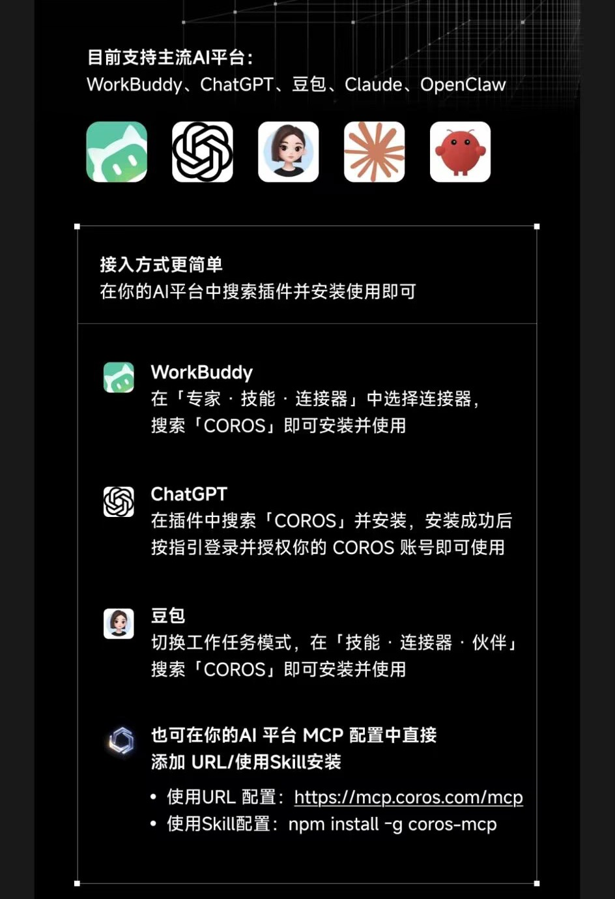

# dsh-coros-mcp

**把 COROS 官方 MCP 接进 [DeepSeek Harness](https://github.com/deepseek-ai/deepseek-harness)（DSH）的完整方案 + 踩坑实录。**

一句话：COROS 官方 MCP 的 6 个写工具 JSON Schema 不合规，会让**整轮对话直接失败**（不是那个工具失败，是这一轮全部 400）。本仓库提供一个 100 行、零依赖的 stdio 代理把它修掉，外加一份可以照抄的接入教程。

```
Invalid schema for function 'mcp__coros__createScheduledWorkout':
Pointer '/$defs/Section' does not exist
```

如果你在别的地方见过这句报错，找对地方了。

## 下载这两个文件就能用

| 文件 | 用途 | 直链 |
|---|---|---|
| `coros-mcp-proxy.js` | 唯一需要下载的代码，零依赖、单文件 | [下载][dl-proxy] |
| `cordis.patch.yml` | 合并进 profile 的配置片段 | [下载][dl-patch] |

[dl-proxy]: https://raw.githubusercontent.com/red-tassel-zhang/dsh-coros-mcp/main/coros-mcp-proxy.js
[dl-patch]: https://raw.githubusercontent.com/red-tassel-zhang/dsh-coros-mcp/main/cordis.patch.yml

不需要 clone，也不需要 `npm install`。具体往哪放、怎么改，见 [30 秒接入](#30-秒接入)。

---

## 目录

- [下载这两个文件就能用](#下载这两个文件就能用)
- [为什么需要这个仓库](#为什么需要这个仓库)
- [官方资料](#官方资料)
- [30 秒接入](#30-秒接入)
- [原理：为什么必须是两层](#原理为什么必须是两层)
- [代理做了什么](#代理做了什么)
- [验证](#验证)
- [仓库结构](#仓库结构)
- [排错](#排错)
- [什么时候可以直接删掉这个代理](#什么时候可以直接删掉这个代理)
- [已知局限](#已知局限)

---

## 为什么需要这个仓库

两个独立的问题，缺一个都跑不起来：

**问题 1：鉴权**
COROS 只提供 **OAuth 2.0 保护的远程 MCP**（`https://mcpcn.coros.com/mcp`，另有 `mcpeu` / `mcpus`）。
而 DSH 的 `dsh-mcp-client` 只支持 `stdio` 与 `streamable-http`，后者**只能加静态 `headers`，没有 OAuth 授权流程**。
→ 需要一个本地桥来做 OAuth 登录 / token 刷新，社区现成方案是 [`mcp-remote`](https://www.npmjs.com/package/mcp-remote)。

**问题 2：Schema 不合规**
COROS 服务端把 `$defs` 写在子 schema 内部，`$ref` 却按文档根去指：

```jsonc
{
  "type": "object",
  "properties": {
    "course": {
      "$defs": { "Section": { /* ... */ } },          // ← 嵌在这里
      "properties": {
        "sections": { "items": { "$ref": "#/$defs/Section" } }   // ← 却指文档根
      }
    }
  }
}
```

`#` 表示文档根，根上没有 `$defs` → 指针解析失败。
→ 需要一层能在 schema 到达模型之前把它修好的东西。

受影响的是 6 个工具，全是写操作（读操作都正常，所以现象是"看数据没事，一做课表就炸"）：

| 工具 | 用途 |
|---|---|
| `createScheduledWorkout` | 在某天新建课表 |
| `updateScheduledWorkout` | 改某天的独立课表 |
| `createTrainingPlan` | 新建训练计划 |
| `updateTrainingPlan` | 改训练计划 |
| `createSingleWorkout` | 新建课表模板（库） |
| `updateWorkoutDetails` | 改课表模板（库） |

---

## 官方资料

COROS 官方提供了 MCP 接入，官方自述是「主要运动手表品牌首个官方支持的 MCP」。对外只给两条路径：**HTTP OAuth URL** 或 **Skill（`npm install -g coros-mcp`）**，公开支持的平台是 WorkBuddy、ChatGPT、豆包、Claude、OpenClaw。



- 官方推文（微信公众号）：[COROS MCP 介绍](https://mp.weixin.qq.com/s?__biz=MzkyOTQ5NjE4OQ==&mid=2247592261&idx=2&sn=37a2c37a6e2eaa5ec43850d786fd5c9d&chksm=c3f1deb4c414b0868ec88d826f4777ea578794985ed2ccdf35742c50bf598bc7a12f8f46f4d0) —— 微信文章，需在微信内打开，可能要求过验证
- 官方仓库与接入指南：[coroslab/COROS-MCP](https://github.com/coroslab/COROS-MCP)
- 官方网关：<https://mcp.coros.com/mcp>

这份列表里没有 DeepSeek Harness；而 DSH 的 `dsh-mcp-client` 也不支持需要 OAuth 授权的远程 MCP —— 这正是下面两个问题的来历。

> 截图与链接版权归 COROS 所有，此处仅作事实引用。

---

## 30 秒接入

### 1. 先脱离 DSH，确认 OAuth 能通

```bash
npx -y mcp-remote@0.14.3 https://mcpcn.coros.com/mcp
```

浏览器登录 COROS。成功时 stderr 会打印 `Proxy established successfully between local STDIO and remote StreamableHTTPClientTransport`。
登录态落在 `~/.mcp-auth/mcp-remote-v1/`（带 `offline_access`，30 天有效且能自动续）。

### 2. 把代理放到一个固定位置

只需要 `coros-mcp-proxy.js` 这一个文件，零依赖，放哪都行——建议放在不会被清理的地方，比如 `~/.dsh/coros-proxy/`：

```bash
curl -O https://raw.githubusercontent.com/red-tassel-zhang/dsh-coros-mcp/main/coros-mcp-proxy.js
```

### 3. 写进 profile 的 patch 层

文件：`<DSH_HOME>/profiles/<profile>/cordis.patch.yml`（顶层是 YAML **数组**）

```yaml
- insert:
    - id: mcp-coros
      name: '@deepseek-ai/dsh-mcp-client'
      config:
        serverName: coros
        transport: stdio
        command: node
        args:
          - '/绝对路径/coros-mcp-proxy.js'
          - 'https://mcpcn.coros.com/mcp'
        toolCallTimeoutMs: 120000
```

Windows 上 `command: node` 建议写成 `node.exe` 的绝对路径（例如 `C:/Program Files/nodejs/node.exe`），避免 PATH 里没有。

### 4. 重启 DSH

插件树只在启动时结算，**刷新页面没用**。重启后工具会以 `mcp__coros__<tool>` 出现。

---

## 原理：为什么必须是两层

```
DSH
 └─ dsh-mcp-client（stdio row，serverName: coros）
      └─ coros-mcp-proxy.js      ← 本仓库：修 schema + 透传
           └─ npx mcp-remote     ← 社区桥：OAuth 登录 / 刷新 / token 缓存
                └─ https://mcpcn.coros.com/mcp   ← COROS 官方远程 MCP
```

两层的职责**不可合并**：`mcp-remote` 解决"怎么登录"，代理解决"schema 不合规"。

> 为什么不直接实现成 DSH 插件？
> 因为那等于 fork 一份 `dsh-mcp-client`（要自己实现握手、`tools/list`、`tools/call`、content 投影、超时与取消），
> 换来的只是"配置从一行 YAML 加一个 .js 变成纯 YAML"。而这个代理解决的是**通用问题**，
> 任何 MCP 客户端（Claude Desktop、Cursor、自研）都能用，不该绑死在一个宿主上。

---

## 代理做了什么

只有两件事：

1. 拦截 `tools/list` 的**响应**，把每个工具 `inputSchema` 里嵌套的 `$defs` 提升到根；同名冲突时改名（`Name$nested`）而不是覆盖。
2. 其余所有消息**逐字节透传**，包括 `tools/call` 的参数体（那里面全是用户数据，不该被碰）。

不碰 token、不联网、不落盘。启动方式：

```bash
node coros-mcp-proxy.js <mcp-url> [传给 mcp-remote 的额外参数...]
```

可用环境变量：

| 变量 | 作用 |
|---|---|
| `MCP_REMOTE_NPX_CLI` | 手动指定 `npx-cli.js` 路径（找不到时用） |
| `MCP_REMOTE_SPEC` | 覆盖 `mcp-remote` 的版本，默认 `mcp-remote@0.14.3` |

代理在改写任何 schema 时会把工具名打到 stderr，方便确认它真的生效了。

---

## 验证

最小验证是**拿到真实数据**，不是"工具出现了"：

```
调用 mcp__coros__queryUserInfo        → 返回身高/体重/生日等资料
调用 mcp__coros__queryRecoveryStatus  → 返回恢复百分比
调用 mcp__coros__querySleepOverview   → 返回最近睡眠
```

再验证写操作（这才是原本会炸的那一半）：

```
调用 mcp__coros__createScheduledWorkout / updateScheduledWorkout
```

---

## 仓库结构

```
.
├── coros-mcp-proxy.js      # ← 唯一需要下载的代码：$defs 提升代理（零依赖）
├── cordis.patch.yml        # ← 要合并进 profile 的配置片段
├── test/
│   └── hoist.test.js       # 核心逻辑单测（node:test，6 个用例）
├── docs/
│   ├── tutorial.md         # 完整接入教程：分步、排错表、回滚、方法论
│   └── assets/             # 文档里用到的图
├── promo/                  # 推广素材，跟使用无关（视频、封面、生成脚本）
└── README.md
```

跑一遍单测（不需要网络、不需要 DSH）：

```bash
node --test test/hoist.test.js
```

---

## 排错

| 症状 | 原因 | 处理 |
|---|---|---|
| `Pointer '/$defs/Section' does not exist`，整轮失败 | schema 缺陷被 API 严格校验 | 确认代理在链路上；或临时只留读工具 |
| 工具列表里没有 `mcp__coros__*` | 行没生效 / 未登录 / 启动失败 | 单独跑一次 `npx -y mcp-remote@0.14.3 <url>` 确认登录 |
| `spawn npx ENOENT` / `EINVAL` | Windows 下 `npx` 解析到无扩展名脚本 | 代理已内置解析，或用 `MCP_REMOTE_NPX_CLI` 指定 |
| 调用超时 | `toolCallTimeoutMs` 默认 60s | 调到 `120000` |
| 授权过期 | refresh_token 失效 | 手动跑一次 `mcp-remote` 重新登录 |
| 换了机器失效 | 配置里写死了路径 | 改 `command` 与 `args[0]` |

更多细节见 [`docs/tutorial.md`](docs/tutorial.md)。

---

## 什么时候可以直接删掉这个代理

**COROS 把 `$defs` 挪到根之后。** 判断标准只有一条：

> 不挂代理重启一次，直接调 `mcp__coros__createScheduledWorkout`，不报 schema 错。

那时候配置可以缩成：

```yaml
- insert:
    - id: mcp-coros
      name: '@deepseek-ai/dsh-mcp-client'
      config:
        serverName: coros
        transport: stdio
        command: npx
        args: ['-y', 'mcp-remote@0.14.3', 'https://mcpcn.coros.com/mcp']
        toolCallTimeoutMs: 120000
```

---

## 已知局限

- **只修 `inputSchema`**。`outputSchema` 不需要修：`dsh-mcp-client` 对它能解析则用、不能解析则回退 `JsonValue`，不会让请求失败。
- **依赖 `mcp-remote` 的 OAuth 实现**。它自己维护 `~/.mcp-auth/` 的 token 缓存；`coros-mcp` CLI 用的是另一套 `~/.coros-mcp-skill-gateway-ts/`，两者**不通用**（"CLI 登录过了" ≠ "mcp-remote 登录过了"）。
- **每次启动多 3~5 秒**：npx 解析 + OAuth 发现 + `tools/list`。
- 这个代理是**等宽补丁**，不是通用 JSON Schema 规范化器；它只处理"`$defs` 嵌在子 schema 里、`$ref` 指向文档根"这一种模式。
- 与 COROS / DeepSeek 官方无隶属关系，仅为个人集成记录。

## 参与

| 参与者 | 角色 | 做了什么 |
|---|---|---|
| [red-tassel-zhang](https://github.com/red-tassel-zhang) | 维护者 | 提出思路、在真机上验证、拍板取舍、发布 |
| DeepSeek Harness | 协作 agent | 撞上报错并定位 `$defs` 根因、写代理与测试、起草教程与视频脚本 |

如实记一笔：这个方案是人机协作做出来的——报错是它先撞上的，代理是它先写的，
文档和视频脚本是它先起草的，人负责判断哪儿该改、哪儿该停。

需要说明的是，这只表示本仓库在 **DeepSeek Harness** 这个 agent 的协助下完成，
**不代表 DeepSeek 官方对本仓库的背书**，也不代表 COROS 认可这套做法。
COROS、DeepSeek Harness 及相关商标、截图版权归各自所有者。

想复现同样的协作方式：把 `docs/tutorial.md` 和本文档一起喂给它，让它照着踩一遍坑。

## License

MIT

---

## 推广素材

跟使用无关，单独放在 [`promo/`](promo/) 里：两分钟视频、封面、生成脚本。

- [promo/promo.mp4](promo/promo.mp4) —— **能当教程看的两分钟视频**：症状 → 根因 → 架构 → 下载 → 写配置 → 重启 → 验证 → 排错，走完就等于装完
- [promo/cover.png](promo/cover.png) —— 封面（也用作仓库社交预览图）
- [promo/README.md](promo/README.md) —— 想改文案的话怎么重跑

